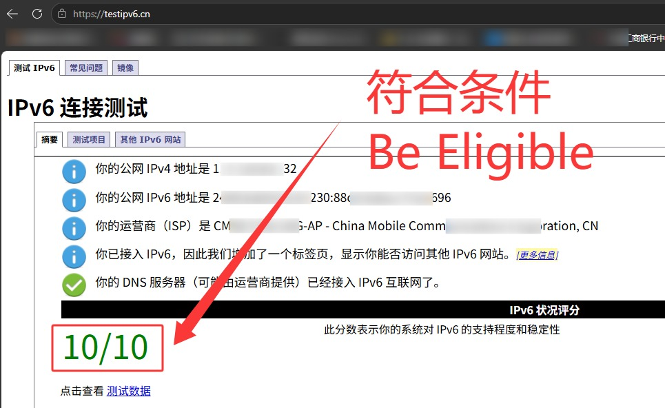
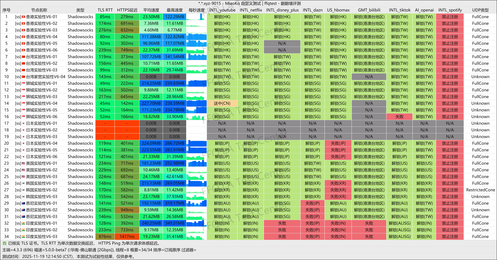
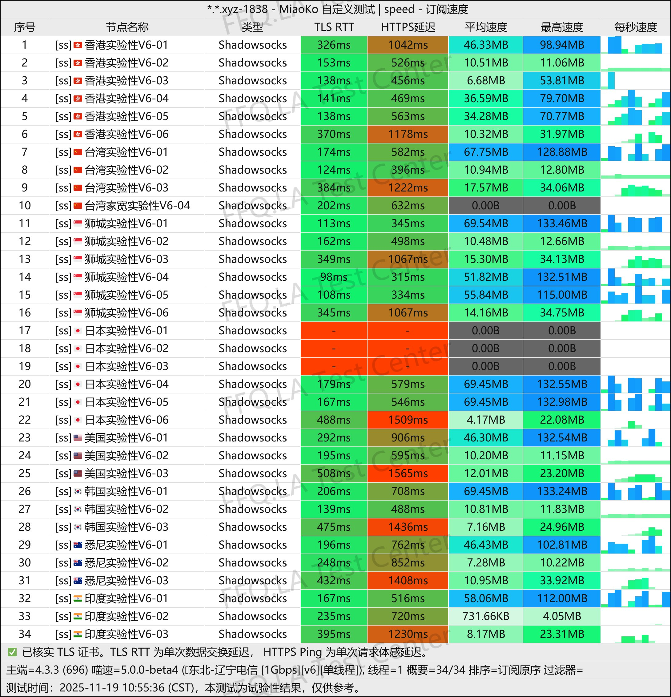
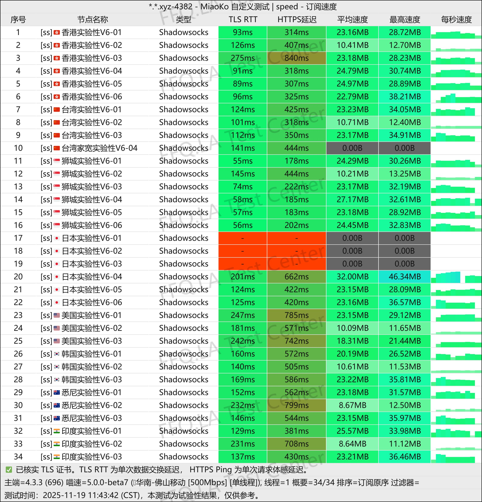
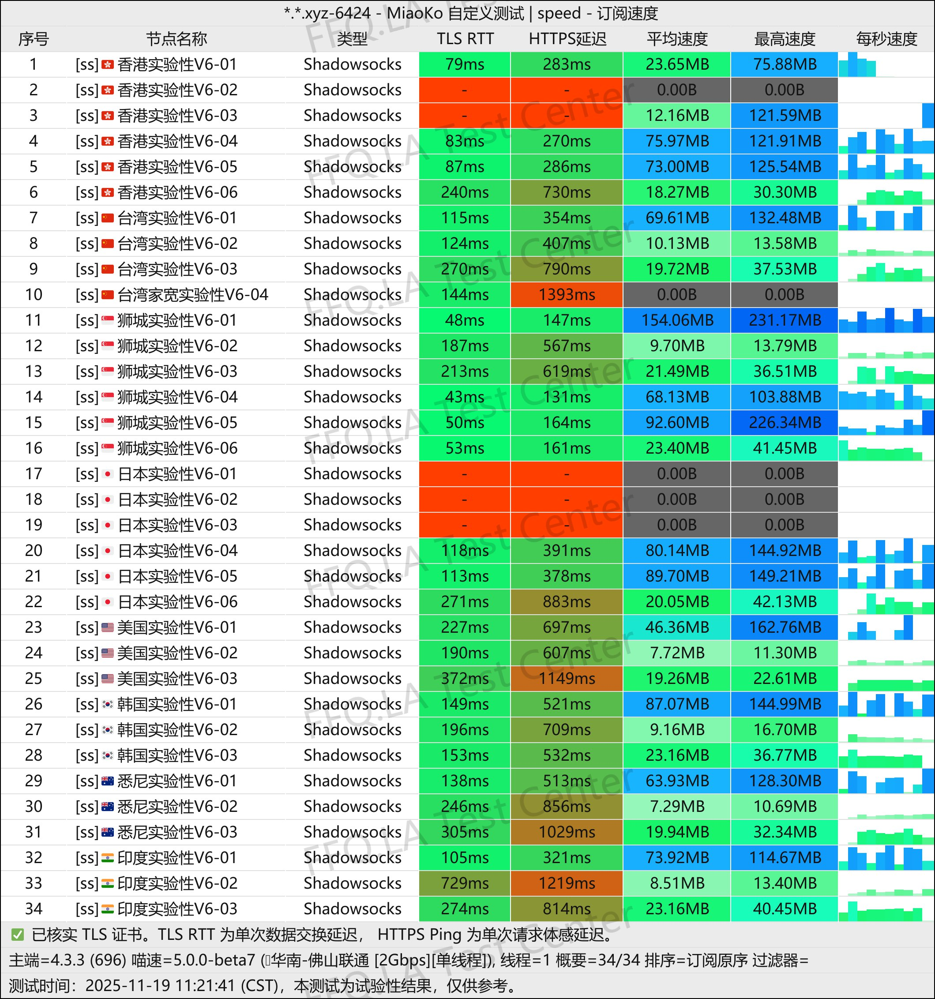
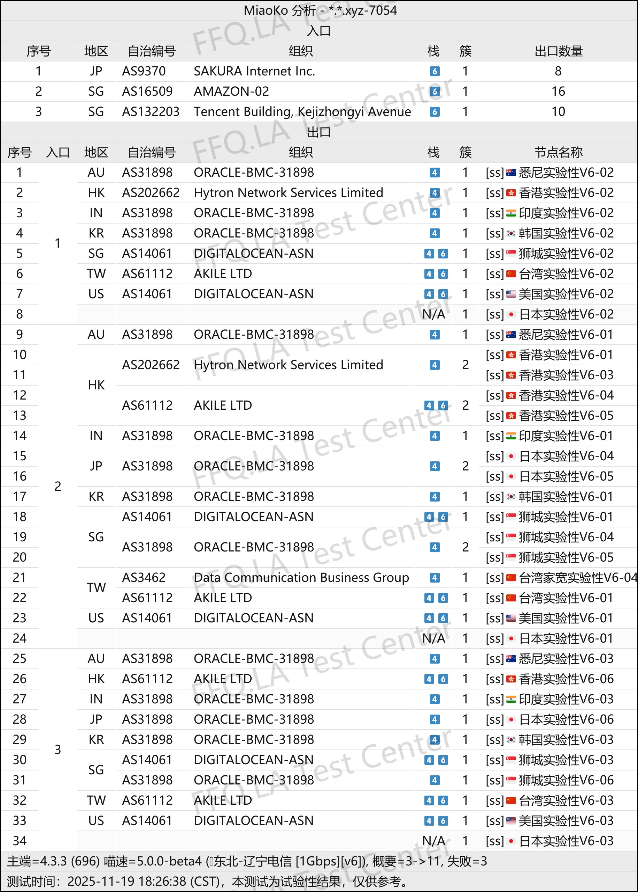

🇨🇳 [中文](README.md) | 🇺🇸 English | 🇷🇺 [Русский](README_RU.md) | 🇮🇷 [فارسی](README_FA.md)

# CrushCloud VPN Official Website (Updated November 6, 2026)

CrushCloud VPN Official Website<br>

Latest Address: [crush91.cc](https://to.iix.im/cr01)<br>
Official Address: [crush91.cc](https://to.iix.im/cr01)<br>

⚠️ [Check](https://to.iix.im/v6) whether your local network supports IPv6. **Turn off your VPN or proxy before testing.**<br>
`Do not purchase this service if your network does not meet the IPv6 requirements.`<br>

<br>

Latest Recommended VPN Services and Node Sharing for 2026: [https://github.com/jdnei/JiChangTuiJian](https://github.com/jdnei/JiChangTuiJian)<br>

## Telegram VPN Deals & Benefits Community #AD

[VPN Giveaway Group](https://331024.de/archives/choujiang) | [VPN Chat Group](https://331024.de/archives/choujiang) | [VPN Trial Group](https://331024.de/archives/choujiang)<br>

[https://331024.de/archives/choujiang](https://331024.de/archives/choujiang)

## Invitation Code

`Register with this invitation code to receive a 1GB trial plan. The provider may cancel this promotion at any time.`

```bash
c6S2AGCw
```

## Overview

CrushCloud VPN specializes in affordable, high-data-allowance plans using exclusively IPv6 servers.

Plans start at ¥4 per month for 150GB of data. The service supports streaming platforms, AI tools, and Emby, making it suitable for everyday use or as a backup VPN.

CrushCloud focuses on delivering excellent value for money through inexpensive, high-data-volume IPv6-only connections.

The service supports streaming platforms, AI tools, `Emby`, and users in China's `Xinjiang region`.

## Advantages

CrushCloud VPN offers 150GB of monthly data for just ¥4, with no restrictions on the number of devices or connection speed.

The service provides broad support for accessing streaming platforms and AI tools and includes optional `Emby service` plans.

Its extremely affordable pricing and relatively good performance on China Unicom connections make it attractive to users with limited budgets and high data requirements.

CrushCloud is also suitable as a low-cost backup VPN.

**Important:** This is an IPv6-only VPN service. Make sure your local network supports IPv6 before purchasing.

## Plans & Pricing

| Plan | Price | Data Allowance | Emby Support |
| --- | --- | --- | --- |
| 150G Monthly Plan with Emby | ¥6/month | 150GB/month | ✅ |
| 300G Monthly Plan with Emby | ¥9.6/month | 300GB/month | ✅ |
| 600G Monthly Plan with Emby | ¥16.3/month | 600GB/month | ✅ |
| 1T Monthly Plan with Emby | ¥26/month | 1024GB/month | ✅ |
| 150G Monthly Plan | ¥4/month | 150GB/month | ❌ |
| 300G Monthly Plan | ¥7.6/month | 300GB/month | ❌ |
| 600G Monthly Plan | ¥14.3/month | 600GB/month | ❌ |
| 1T Monthly Plan | ¥24/month | 1024GB/month | ❌ |
| 2T Monthly Plan | ¥40/month | 2048GB/month | ❌ |

## 📊 Real-World Performance Tests & Analysis

#### 1.1 China Unicom Evening Peak-Hour Speed Test

<br>

#### 1.2 China Telecom Evening Peak-Hour Speed Test

<br>

#### 1.3 China Mobile Evening Peak-Hour Speed Test

<br>

#### 2. Streaming Service Unblocking Report

<br>

#### 3. Exit Node and Network Entry Analysis

<br>
