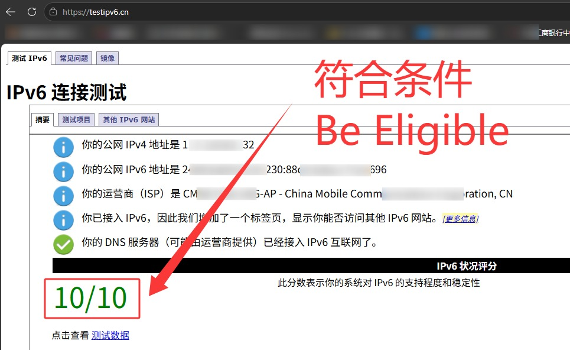
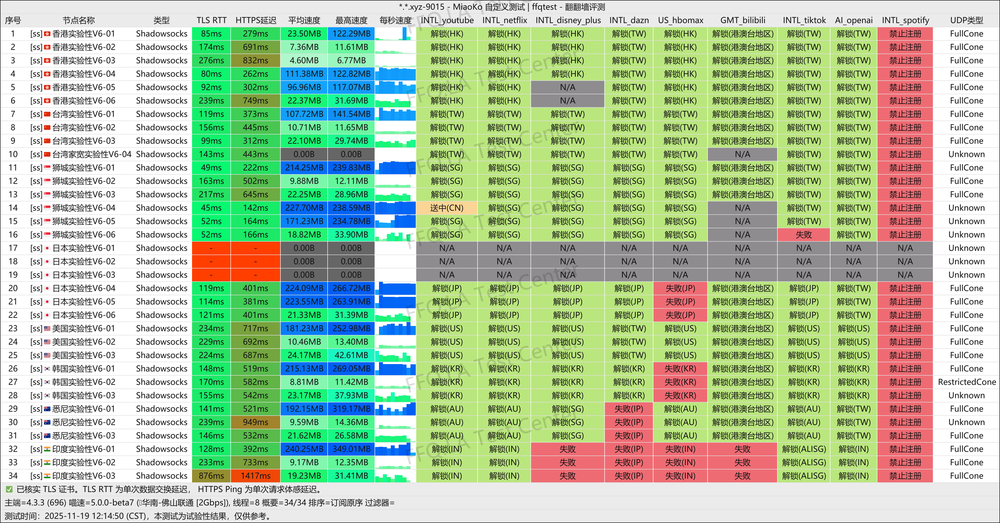
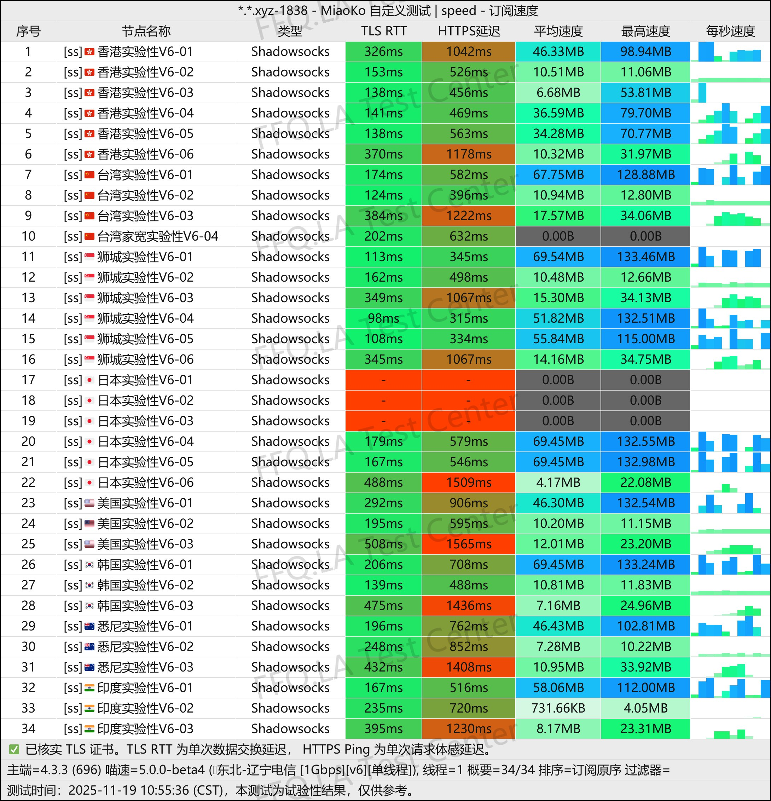
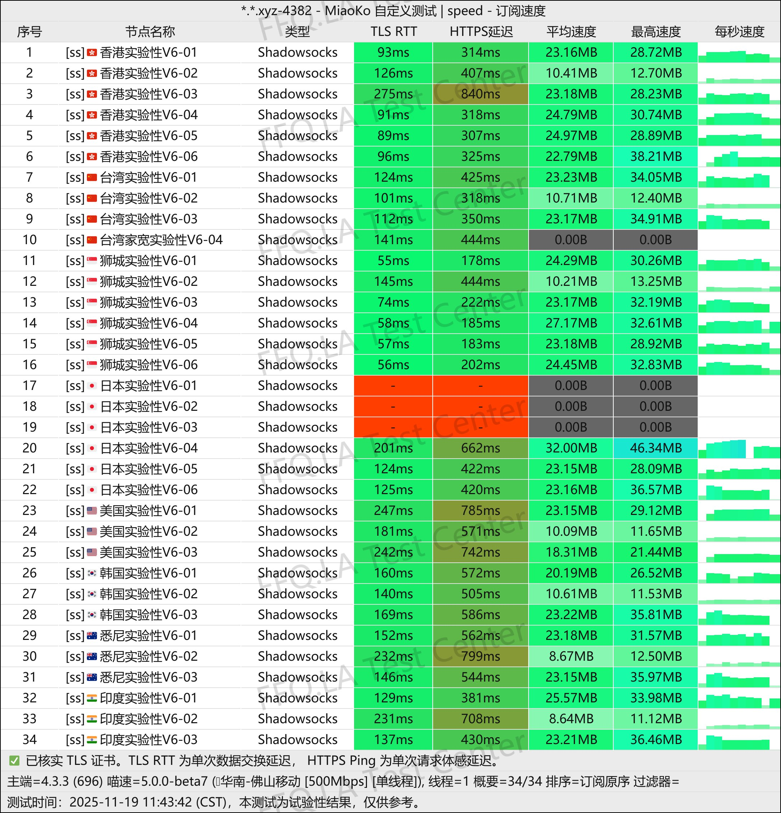
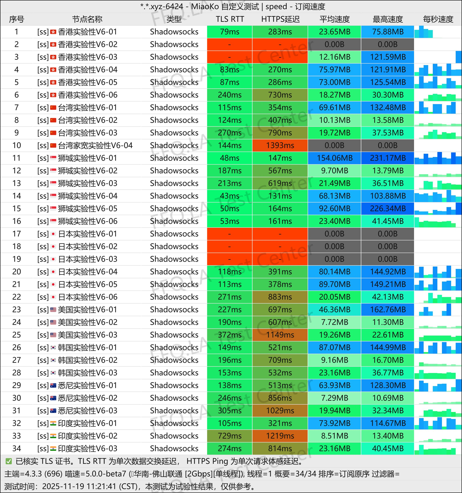
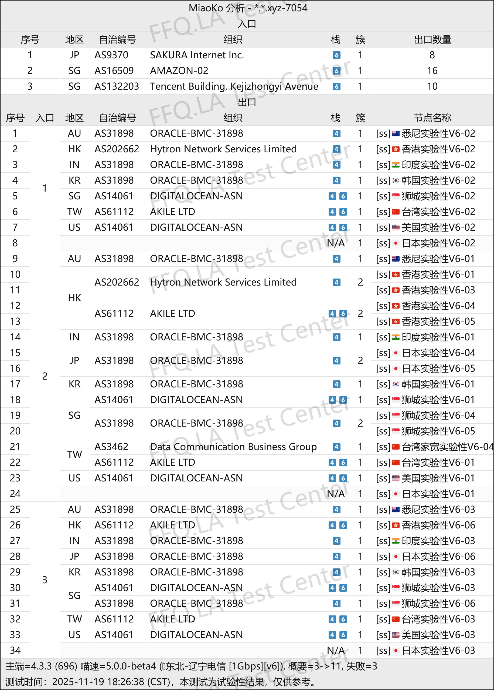

 🇨🇳 [中文](README.md) | 🇺🇸 [English](README_EN.md) | 🇷🇺 [Русский](README_RU.md) | 🇮🇷 فارسی
# آدرس رسمی VPN کراش‌کلاد (CrushCloud) -(به‌روزرسانی 8 نوامبر 2026)
وب‌سایت رسمی VPN کراش‌کلاد (CrushCloud)<br>

جدیدترین آدرس: [crush91.cc](https://to.iix.im/cr01)<br>
آدرس رسمی: [crush91.cc](https://to.iix.im/cr01)<br>

⚠️ برای بررسی اینکه شبکه اینترنت شما از IPv6 پشتیبانی می‌کند، [اینجا کلیک کنید](https://to.iix.im/v6). **پیش از انجام آزمایش، VPN یا پروکسی خود را خاموش کنید.**<br>
`اگر شبکه شما شرایط لازم برای استفاده از IPv6 را ندارد، این سرویس را خریداری نکنید.`<br>

<br>

معرفی بهترین سرویس‌های VPN و اشتراک‌گذاری سرورها در سال ۲۰۲۶: [https://github.com/jdnei/JiChangTuiJian](https://github.com/jdnei/JiChangTuiJian)<br>

## انجمن تلگرامی تخفیف‌ها و مزایای VPN #AD

[گروه قرعه‌کشی VPN](https://331024.de/archives/choujiang) | [گروه گفت‌وگوی VPN](https://331024.de/archives/choujiang) | [گروه آزمایش رایگان VPN](https://331024.de/archives/choujiang)<br>

[https://331024.de/archives/choujiang](https://331024.de/archives/choujiang)

## کد دعوت

`با ثبت‌نام از طریق این کد دعوت، یک طرح آزمایشی با حجم 1GB دریافت می‌کنید. ارائه‌دهنده می‌تواند این جشنواره را در هر زمانی لغو کند.`

```bash
c6S2AGCw
```

## معرفی

CrushCloud VPN یک سرویس اقتصادی است که بر ارائه بسته‌های اینترنتی پرحجم با استفاده انحصاری از سرورهای IPv6 تمرکز دارد.

قیمت طرح‌های این سرویس از ماهانه ¥4 برای 150GB ترافیک آغاز می‌شود.

CrushCloud از سرویس‌های پخش آنلاین، ابزارهای هوش مصنوعی و Emby پشتیبانی می‌کند و برای استفاده روزمره یا به‌عنوان VPN پشتیبان مناسب است.

این سرویس با ارائه اتصالات ارزان‌قیمت، ترافیک بالا و سرورهای مبتنی بر IPv6، بر نسبت مناسب قیمت به امکانات تمرکز دارد.

CrushCloud همچنین از دسترسی به سرویس‌های پخش آنلاین، ابزارهای هوش مصنوعی، `Emby` و استفاده کاربران در `منطقه سین‌کیانگ چین` پشتیبانی می‌کند.

## مزایا

CrushCloud VPN با پرداخت تنها ¥4 در ماه، 150GB ترافیک ارائه می‌دهد و محدودیتی برای تعداد دستگاه‌های متصل یا سرعت اتصال در نظر نمی‌گیرد.

این سرویس از دسترسی به طیف گسترده‌ای از پلتفرم‌های پخش آنلاین و ابزارهای هوش مصنوعی پشتیبانی می‌کند و طرح‌هایی همراه با `سرویس Emby` نیز ارائه می‌دهد.

قیمت بسیار پایین و عملکرد نسبتاً مناسب در شبکه China Unicom، این سرویس را برای کاربران دارای بودجه محدود و نیاز به حجم بالای اینترنت جذاب می‌کند.

CrushCloud همچنین گزینه‌ای مناسب برای استفاده به‌عنوان VPN پشتیبان کم‌هزینه است.

**نکته مهم:** این سرویس VPN فقط از IPv6 استفاده می‌کند. پیش از خرید، حتماً بررسی کنید که اتصال اینترنت محلی شما از IPv6 پشتیبانی می‌کند.

## طرح‌ها و قیمت‌ها

| نام طرح | قیمت | حجم ترافیک | پشتیبانی از Emby |
| --- | --- | --- | --- |
| طرح ماهانه 150G همراه با Emby | ¥6/ماه | 150GB/ماه | ✅ |
| طرح ماهانه 300G همراه با Emby | ¥9.6/ماه | 300GB/ماه | ✅ |
| طرح ماهانه 600G همراه با Emby | ¥16.3/ماه | 600GB/ماه | ✅ |
| طرح ماهانه 1T همراه با Emby | ¥26/ماه | 1024GB/ماه | ✅ |
| طرح ماهانه 150G | ¥4/ماه | 150GB/ماه | ❌ |
| طرح ماهانه 300G | ¥7.6/ماه | 300GB/ماه | ❌ |
| طرح ماهانه 600G | ¥14.3/ماه | 600GB/ماه | ❌ |
| طرح ماهانه 1T | ¥24/ماه | 1024GB/ماه | ❌ |
| طرح ماهانه 2T | ¥40/ماه | 2048GB/ماه | ❌ |

## 📊 آزمایش‌های عملی عملکرد و تحلیل نتایج

#### ۱.۱ آزمایش سرعت China Unicom در ساعات اوج مصرف شبانه

<br>

#### ۱.۲ آزمایش سرعت China Telecom در ساعات اوج مصرف شبانه

<br>

#### ۱.۳ آزمایش سرعت China Mobile در ساعات اوج مصرف شبانه

<br>

#### ۲. گزارش رفع محدودیت سرویس‌های پخش آنلاین

<br>

#### ۳. تحلیل سرورهای خروجی و مسیرهای ورودی شبکه

<br>
