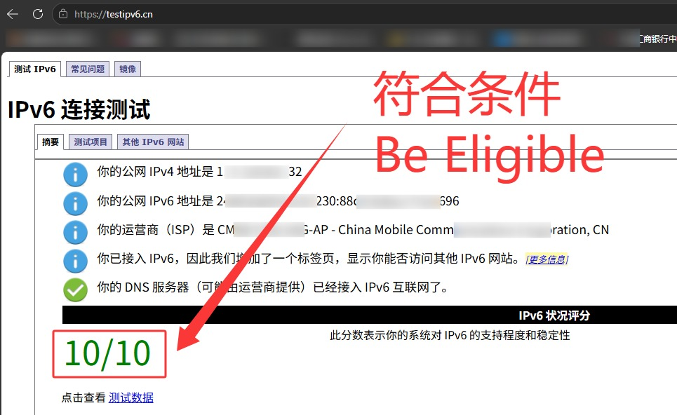
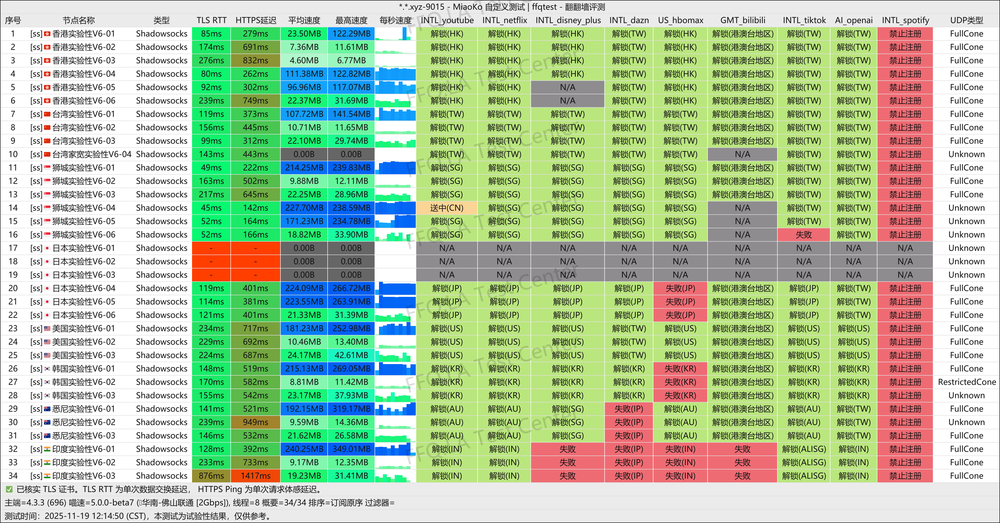
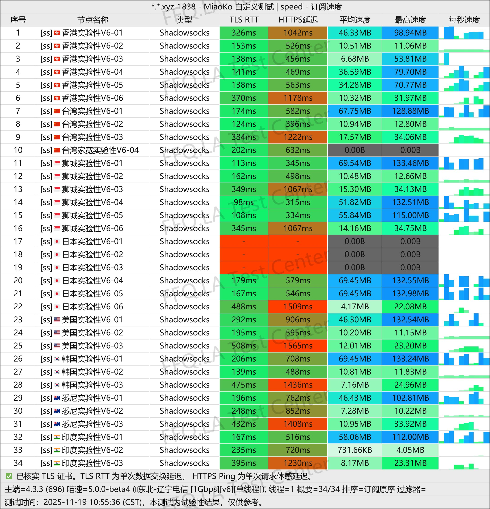
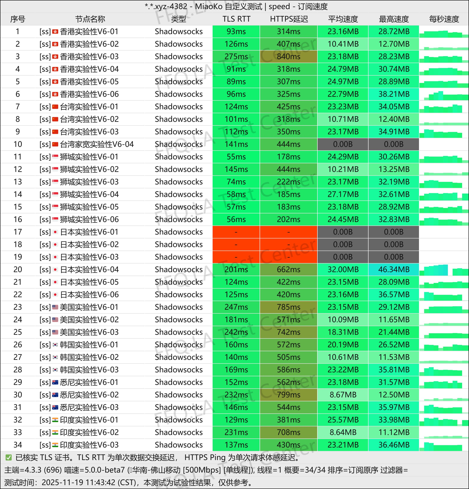
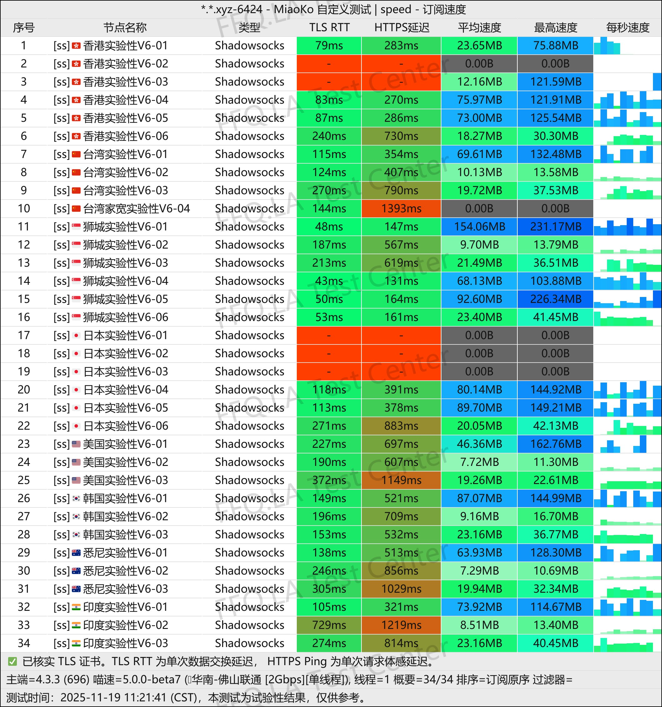
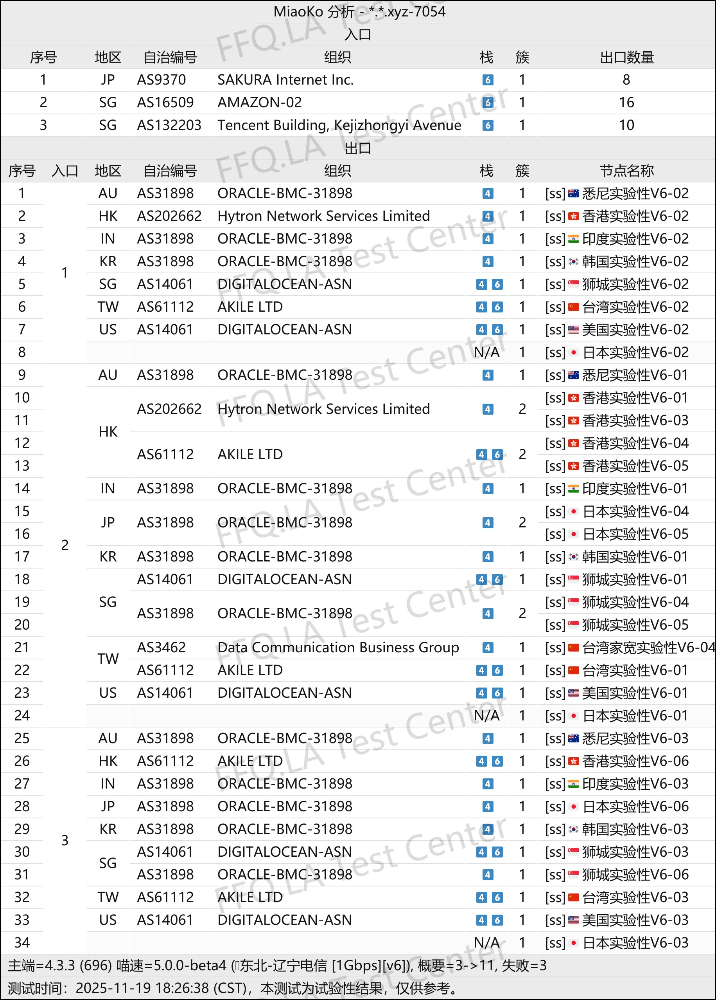

🇨🇳 [中文](README.md) | 🇺🇸 [English](README_EN.md) | 🇷🇺 Русский | 🇮🇷 [فارسی](README_FA.md)

# Официальный сайт CrushCloud VPN (обновлено 11 ноября 2026)

Официальный сайт VPN-сервиса CrushCloud<br>

Новый адрес: [crush91.cc](https://to.iix.im/cr01)<br>
Официальный адрес: [crush91.cc](https://to.iix.im/cr01)<br>

⚠️ [Проверьте](https://to.iix.im/v6), поддерживает ли ваше локальное интернет-соединение IPv6. **Перед проверкой обязательно отключите VPN или прокси.**<br>
`Не покупайте этот сервис, если ваше интернет-соединение не соответствует требованиям IPv6.`<br>

<br>

Лучшие VPN-сервисы 2026 года: рекомендации и подборка серверов: [https://github.com/jdnei/JiChangTuiJian](https://github.com/jdnei/JiChangTuiJian)<br>

## Telegram-сообщество VPN: акции, скидки и бонусы #AD

[Группа розыгрышей VPN](https://331024.de/archives/choujiang) | [Чат VPN](https://331024.de/archives/choujiang) | [Группа тестирования VPN](https://331024.de/archives/choujiang)<br>

[https://331024.de/archives/choujiang](https://331024.de/archives/choujiang)

## Пригласительный код

`Зарегистрируйтесь с этим пригласительным кодом, чтобы получить пробный тариф с 1GB трафика. Провайдер может отменить акцию в любое время.`

```bash
c6S2AGCw
```

## Описание

CrushCloud VPN — бюджетный сервис, специализирующийся на предоставлении больших объёмов трафика через серверы, работающие исключительно по протоколу IPv6.

Стоимость тарифов начинается от ¥4 в месяц за 150GB трафика.

Сервис поддерживает доступ к стриминговым платформам, инструментам искусственного интеллекта и Emby, поэтому подходит для повседневного использования или в качестве резервного VPN.

CrushCloud ориентирован на максимально выгодное соотношение цены и возможностей благодаря недорогим тарифам с большим объёмом данных и подключениями исключительно через IPv6.

Сервис также поддерживает использование стриминговых платформ, ИИ-инструментов, `Emby` и доступ пользователей из `Синьцзянского региона Китая`.

## Преимущества

CrushCloud VPN предлагает 150GB ежемесячного трафика всего за ¥4 без ограничений на количество подключаемых устройств и скорость соединения.

Сервис обеспечивает доступ к широкому спектру стриминговых платформ и инструментов искусственного интеллекта, а также предлагает тарифы с дополнительным `сервисом Emby`.

Очень низкая стоимость подписки и относительно хорошие показатели соединения в сети China Unicom делают CrushCloud привлекательным для пользователей с ограниченным бюджетом и высокими потребностями в трафике.

Сервис также хорошо подходит в качестве недорогого резервного VPN.

**Важно:** Этот VPN работает исключительно через IPv6. Перед покупкой убедитесь, что ваше локальное интернет-соединение поддерживает IPv6.

## Тарифы и цены

| Название тарифа | Цена | Объём трафика | Поддержка Emby |
| --- | --- | --- | --- |
| Месячный тариф 150G с Emby | ¥6/месяц | 150GB/месяц | ✅ |
| Месячный тариф 300G с Emby | ¥9.6/месяц | 300GB/месяц | ✅ |
| Месячный тариф 600G с Emby | ¥16.3/месяц | 600GB/месяц | ✅ |
| Месячный тариф 1T с Emby | ¥26/месяц | 1024GB/месяц | ✅ |
| Месячный тариф 150G | ¥4/месяц | 150GB/месяц | ❌ |
| Месячный тариф 300G | ¥7.6/месяц | 300GB/месяц | ❌ |
| Месячный тариф 600G | ¥14.3/месяц | 600GB/месяц | ❌ |
| Месячный тариф 1T | ¥24/месяц | 1024GB/месяц | ❌ |
| Месячный тариф 2T | ¥40/месяц | 2048GB/месяц | ❌ |

## 📊 Практические тесты производительности и анализ

#### 1.1 Результаты тестирования скорости China Unicom в вечерние часы пик

<br>

#### 1.2 Результаты тестирования скорости China Telecom в вечерние часы пик

<br>

#### 1.3 Результаты тестирования скорости China Mobile в вечерние часы пик

<br>

#### 2. Отчёт о разблокировке стриминговых сервисов

<br>

#### 3. Анализ выходных серверов и входящих сетевых маршрутов

<br>
